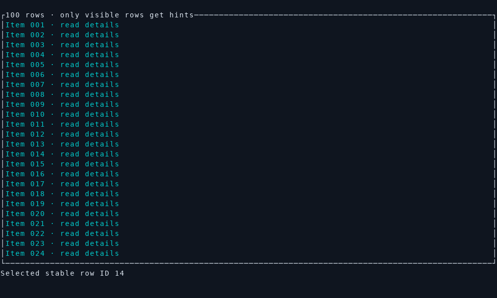

# RataHop

**Hop to any control. Keep your hands on the keyboard.**

Vimium-style keyboard hints for Rust terminal interfaces. Register visible
controls, show short labels, and return a selected control ID to your application.

The first implementation includes a dependency-free core, a Ratatui adapter,
and a working integration in Wire, a terminal news reader. This is a local,
pre-release project; crate names and public APIs are not yet finalized or published.

## Try it



The animation above is recorded from the showcase example with
[docs/demo/record.sh](docs/demo/record.sh).

```sh
cargo run -p ratahop-ratatui --example showcase -- form
cargo run -p ratahop-ratatui --example showcase -- table
cargo run -p ratahop-ratatui --example showcase -- split
cargo run -p ratahop --example headless
```

Press **f**, then type a label. **Backspace** edits the prefix and **Esc** cancels.
Inside text entry, **Alt+f** shows hints. Crowded screens use a named picker;
**Page Up / Page Down** browse its pages. Selection works across all pages.

## Add it to an application

Until publication, use a local path:

```toml
[dependencies]
ratahop-ratatui = { path = "../ratahop/crates/ratahop-ratatui" }
```

The adapter targets **Ratatui 0.30** and **Crossterm 0.29**. Crossterm conversion
is optional (`default-features = false`); use normalized `Input` and
`next_page` / `previous_page` with another event backend. The core `ratahop`
crate has no dependencies. The minimum supported Rust version is **1.88**,
set by the adapter's dependency tree and verified with tests and Clippy
(see the [compatibility policy](docs/COMPATIBILITY.md)).

Keep a `Hop<Action>` in your app state, with `Action: Clone + Eq`:

```rust
use ratahop_ratatui::{rect, Hop, Target, Outcome};

// After normal layout/rendering: register enabled, visible controls.
app.hop.update(vec![
    Target::new(Action::Save, rect(save_area), "Save profile"),
    Target::new(Action::Close, rect(close_area), "Close dialog"),
], frame.area(), None);
frame.render_widget(&app.hop, frame.area()); // Overlay renders last.

// In the existing event handler: global emergency shortcuts may run first.
let outcome = app.hop.handle_key(key);
if let Outcome::Selected(action) = &outcome {
    app.dispatch(action.clone());
}
if outcome.consumed() {
    return; // Prevent hint characters from triggering normal shortcuts.
}
// Your activation shortcut calls app.hop.start()? from the latest layout.
```

This excerpt illustrates placement in an existing app. The [showcase example](crates/ratahop-ratatui/examples/showcase.rs)
and the crate's tested documentation provide complete runnable/compilable examples.

## Behavior and responsibilities

- Deterministic, unique, prefix-free labels: `a` and `as` cannot select different
  controls in one session. A single target still requires its displayed letter.
- Stable labels during a session. Updating target order, geometry, IDs, titles,
  anchors, scope, or viewport cancels the session instead of remapping input.
- Invalid characters preserve the prefix and show feedback. Active input is
  consumed. Repeated/released Crossterm events cannot accidentally select controls.
- Targets are clipped to the viewport; offscreen and zero-sized controls are
  excluded. Duplicate IDs within an active scope are reported as errors.
- Preferred anchors and collision detection keep badges inside controls.
  If badges cannot fit, the whole view becomes a paged picker with target names.
- ASCII hint alphabets guarantee one cell per character. Surrounding Unicode
  text is supported; badges clear complete wide glyphs they overwrite.
- The host owns shortcut activation, scopes, focus, action dispatch, terminal
  setup, and async scheduling. Revalidate selected IDs if your data can change.

Register current targets **before** routing input after a layout/data change.
For updates that reuse IDs for different content, explicitly cancel the session
or include a generation in your IDs. Modal hosts should provide only modal targets
or use `Target::scope` with the active scope supplied to `update`.

Deduplicate repeated actions yourself, or assign distinct control IDs if you want
multiple placements to show separate hints. The adapter does not discover controls
from rendered text, infer occlusion, or synthesize mouse events. Very small
terminals may need enlargement to read the picker. Alphabet customization and
`Hop::theme` support different layouts and monochrome themes.

## Real application integration

Wire is integrated at `../tui-news-feed`:

```sh
cd ../tui-news-feed
cargo run -- --samples
```

Use **f** on the feed and **Alt+f** in dialogs. Existing mouse targets supply hint
geometry; duplicate actions share a label. Live feed refreshes wait until hint
selection completes, and mouse input / resizing cancels hints.

[Integration notes and patch](integrations/wire-feed/README.md) ·
[Validation record](docs/VALIDATION.md) · [Integration guide](docs/GUIDE.md) ·
[Compatibility policy](docs/COMPATIBILITY.md) ·
[Development plan](docs/PLAN.md) · [Changelog](CHANGELOG.md)

## Development

```sh
cargo fmt --all -- --check
cargo clippy --workspace --all-targets -- -D warnings
cargo test --workspace --all-targets
cargo test --workspace --doc
cargo test -p ratahop-ratatui --no-default-features
cargo doc --workspace --no-deps
```

See [CONTRIBUTING.md](CONTRIBUTING.md). License: [MIT](LICENSE-MIT) or
[Apache-2.0](LICENSE-APACHE), at your option.
